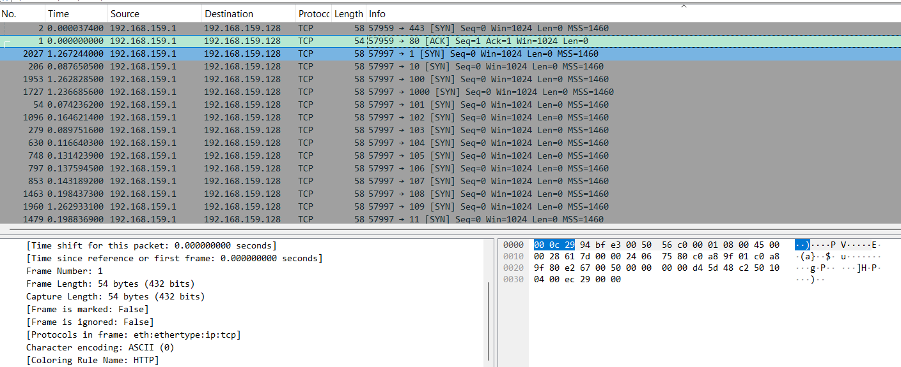
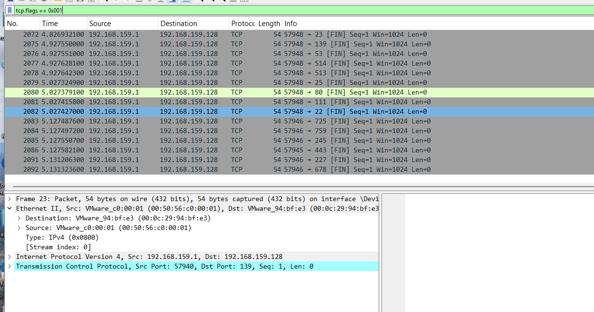
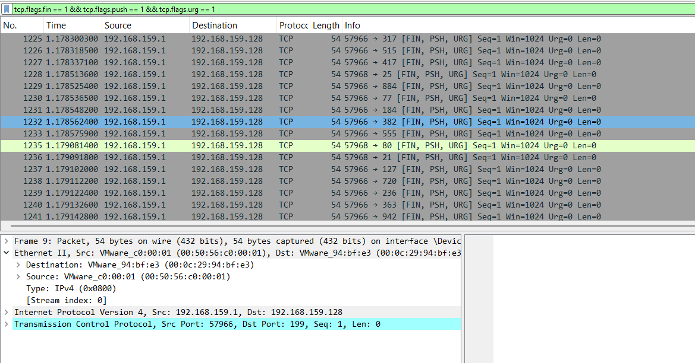
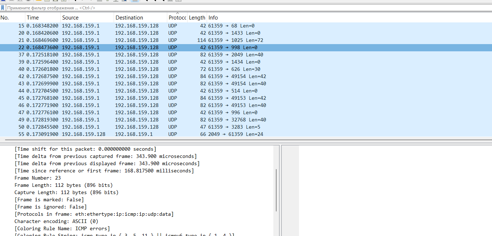

# Домашнее задание к занятию «Уязвимости и атаки на информационные системы»

### Задание 1

Скачайте и установите виртуальную машину Metasploitable: https://sourceforge.net/projects/metasploitable/.

Это типовая ОС для экспериментов в области информационной безопасности, с которой следует начать при анализе уязвимостей.

Просканируйте эту виртуальную машину, используя **nmap**.

Попробуйте найти уязвимости, которым подвержена эта виртуальная машина.

Сами уязвимости можно поискать на сайте https://www.exploit-db.com/.

Для этого нужно в поиске ввести название сетевой службы, обнаруженной на атакуемой машине, и выбрать подходящие по версии уязвимости.

Ответьте на следующие вопросы:

- Какие сетевые службы в ней разрешены?
- Какие уязвимости были вами обнаружены? (список со ссылками: достаточно трёх уязвимостей)
  
Разрешенные сетевые службы: перечислите открытые порты и соответствующие службы, полученные при сканировании Nmap 

Обнаруженные уязвимости 

vsftpd 2.3.4 Backdoor: https://www.exploit-db.com/exploits/17491

UnrealIRCd 3.2.8.1 Backdoor: https://www.exploit-db.com/exploits/16922

Samba 3.0.20 usermap_script: https://www.exploit-db.com/exploits/16320 (если этот порт также открыт при сканировании).

### Задание 2

Проведите сканирование Metasploitable в режимах SYN, FIN, Xmas, UDP.

Запишите сеансы сканирования в Wireshark.

Ответьте на следующие вопросы:

- Чем отличаются эти режимы сканирования с точки зрения сетевого трафика?
- Как отвечает сервер?
Ответы на вопросы задания
### 1. Чем отличаются эти режимы сканирования с точки зрения сетевого трафика?
Отличия заключаются в комбинации флагов TCP, которые Nmap устанавливает в отправляемых пакетах, и в том, как строится (или не строится) сессия.

SYN (-sS): Это «полуоткрытое» сканирование. Nmap отправляет пакет с флагом SYN. Если порт открыт, сервер отвечает SYN/ACK. Nmap, получив этот ответ, не отправляет ACK для завершения рукопожатия, а сразу сбрасывает соединение пакетом RST. Это делает сканирование быстрым и относительно скрытным, так как полноценное соединение не устанавливается и многие приложения не успевают записать его в лог .

FIN (-sF): Nmap отправляет пакет с единственным флагом FIN. Этот флаг обычно используется для корректного закрытия уже установленного соединения, поэтому пакет выглядит необычно для открытого порта .

Xmas (-sX): Nmap отправляет пакет с комбинацией флагов FIN, PSH и URG. В Wireshark такой пакет выглядит «подсвеченным» множеством флагов, из-за чего сканирование и получило название «рождественского» (Xmas) . Это также попытка обойти простые фильтры, которые могут блокировать только SYN-пакеты.

UDP (-sU): Здесь вообще нет TCP-флагов, так как используется протокол UDP. Nmap отправляет пустой UDP-заголовок (или специфичный для службы payload) на целевой порт . Это принципиально другой тип трафика, не связанный с установлением соединений.

### 2. Как отвечает сервер?
Ответ сервера (Metasploitable) зависит от состояния порта (открыт/закрыт) и типа сканирования.

На SYN-сканирование:

Открытый порт: Сервер отвечает пакетом с флагами SYN/ACK .

Закрытый порт: Сервер отвечает пакетом с флагом RST (или RST/ACK) .

На FIN и Xmas-сканирование :

Открытый порт: Сервер не отвечает. В Nmap такой порт будет помечен как open|filtered .

Закрытый порт: Сервер отвечает пакетом с флагом RST. Nmap понимает, что порт закрыт .

На UDP-сканирование:

Открытый порт: Сервер может не ответить, либо, если служба настроена отвечать на пустые пакеты, прислать UDP-ответ. В Nmap это часто выглядит как open|filtered .

Закрытый порт: Серверобычно присылает ICMP-сообщение «Destination Unreachable, Port Unreachable» (Тип 3, Код 3). Это верный признак закрытого UDP-порта в захвате .
*Приведите ответ в свободной форме.*
